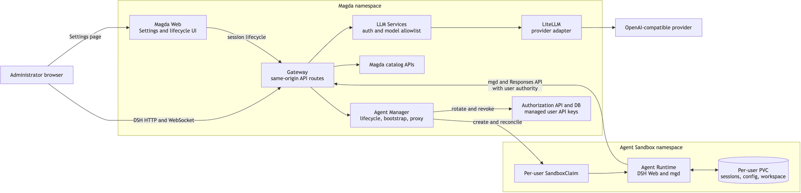

# Agent Workspace architecture

## Status and scope

Agent Workspace is an opt-in Magda capability that gives each authorized user a
private, browser-based coding and data-analysis agent. The MVP embeds DeepSeek
Harness (DSH) Web under **Settings → Agent Workspace**, bundles the `mgd` CLI,
and connects the agent to Magda using the current user's authority.

The feature is disabled by default with `global.agentWorkspace.enabled=false`.
Access requires the grantable `agentWorkspace/access` permission, which is
assigned through ordinary Magda roles (see [Workspace access](#workspace-access)).
It supports one current workspace per user.

## Architecture

The browser uses same-origin Settings, lifecycle, DSH HTTP/WebSocket, and LLM
routes. Agent execution is isolated in a per-user Sandbox and PVC; model-provider
credentials remain in the Magda namespace.

### Components

- **Magda Web** exposes the feature-flagged Settings route to users whose
  `whoami` permissions include `agentWorkspace/access`, and renders
  lifecycle state. When ready, it embeds the runtime through
  `/api/v0/agent/runtime/` with DSH's native responsive sidebar, session history,
  Search, and collapse/expand navigation.
- **Agent Manager** is stateless. It authenticates the Gateway session through
  `whoami`, checks the `agentWorkspace/access` policy decision, manages Kubernetes resources,
  bootstraps the runtime, proxies DSH HTTP/WebSocket traffic, and reconciles idle
  workspaces.
- **Kubernetes Agent Sandbox** provides the per-user execution boundary. The
  qualified release is Kubernetes Agent Sandbox v1.0.4. The installation renders
  exactly one selected runc, gVisor, or Kata template and warm pool.
- **Agent Runtime** pins DSH, bundles `mgd`, Debian Python tooling and a
  digest-pinned `uv`, and applies a deployment-owned Cordis profile. The
  workspace is mounted at `/data/workspace`; runtime configuration, DSH state,
  purpose-specific Python environments, package caches and install temporaries
  are stored on the same per-user PVC.
- **LLM Services** independently authenticates the Magda user and allowlists
  deployment-selected model IDs before proxying to LiteLLM. Provider errors are
  sanitized at this boundary.
- **LiteLLM** holds the provider configuration. Provider credentials enter only
  through a Kubernetes Secret and are never sent to the browser or Sandbox.
- **Authorization API and DB migration** provide expiring system-managed API
  keys. These keys are private, hidden from public key lists, and immutable
  through public key-management routes.

## Lifecycle and resource identity

A user UUID and stable installation ID map deterministically to the claim name
`magda-agent-<installation ID>-<user UUID>`. Claims carry both
`agent.magda.io/installation-id` and `agent.magda.io/user-id` labels.
The user-visible states are:

`ABSENT`, `ALLOCATING`, `BOOTSTRAPPING`, `READY`, `SUSPENDING`, `SUSPENDED`,
`RESUMING`, `DELETING`, `FAILED`, and `DEGRADED`.

Provisioning performs these operations:

1. Create the installation-scoped user's `SandboxClaim` from the selected warm
   pool, making interrupted provisioning discoverable before issuing a secret.
2. Rotate the installation-scoped reserved managed API key. Its expiry follows
   the current eight-hour inactivity deadline.
3. Wait for the claim and Sandbox Pod to become ready.
4. Send a one-time bootstrap payload through `pods/exec` over stdin.
5. Write `mgd` configuration and DSH environment to mode-0600 files on the PVC.
6. Restart the runtime container and require post-bootstrap readiness before
   returning `READY`.

Idle `READY` workspaces are suspended even if an otherwise idle runtime WebSocket
remains open. While the workspace iframe is visible, the Settings page continues
polling lifecycle status so suspension replaces the stale iframe with the Resume
UI. Resume reuses the PVC and Sandbox and renews the deadline. Reset, explicit deletion, and logout revoke the key,
close sockets, delete the claim and storage, and remove all DSH sessions and
workspace files. Logout waits for cleanup before destroying the Magda session.
Any destructive cleanup that is only partially completed remains durably
`DELETING`; reconciliation retries key revocation and claim/PVC deletion after a
dependency recovers rather than stranding the workspace in `FAILED`. Reset also
persists its replacement intent, so successful retry cleanup provisions the fresh
workspace requested by the user. Reconciliation is single-flight globally and
shares the per-user lifecycle lock with UI actions; Terminate durably clears the
intent and cancels any in-flight replacement before it can be reprovisioned.

### One workspace, multiple sessions

A Magda user has one current SandboxClaim, PVC, filesystem workspace, and managed
API key per Magda installation. That Sandbox can hold multiple native DSH
**Sessions**. New Session creates another conversation in the existing
`/data/workspace`; it does not allocate another Sandbox, PVC, or key. The DSH
sidebar provides creation, history, rename, Search, switching, and reopening.
Sessions and files survive browser refresh, Pod replacement, and suspend/resume
because DSH state and `/data/workspace` share the PVC. Reset, Terminate, and
logout remove all sessions and files with that single workspace.

The PVC uses deployment-owned names rather than upstream product names:

- `/data/agent-home` contains DSH profiles, credentials, session logs, and storage;
- `/data/workspace/agent-harness/default-workspace` is the default working tree.

The pinned DSH release hard-codes its `deepseek-harness` directory segment, so
the runtime Dockerfile performs a fail-closed, version-specific replacement when
building the image. This pre-release path rename deliberately has no PVC migration:
reset local test workspaces after deploying it so the new workspace starts with
only the deployment-owned names.

## Workspace access

One grantable OPA operation, `agentWorkspace/access` (#3858), lets an
authenticated user operate their **own** Agent Workspace: start, status,
resume, reset, terminate, the DSH runtime HTTP proxy, DSH WebSocket upgrades,
and the Workspace's model access through LLM Services. There are no
action-specific Workspace operations.

- **Registration:** the consolidated authorization migration
  `V2_4__agent_workspace_and_skills.sql` registers the `agentWorkspace`
  resource, operation and unconstrained **Access Own Agent Workspace**
  permission together with the Agent Skill resources and unassigned stock
  **Agent Workspace Users** role. It is not granted
  to Authenticated Users, and **Agent Skills Admins** does not imply it.
- **Policy:** `magda-opa/policies/agentWorkspace/allow.rego`, reached from the
  entrypoint only for the exact URI `agentWorkspace/access`. It allows a
  non-anonymous user holding an unconstrained permission on the `agentWorkspace`
  resource. Global administrators keep access to their own Workspace through the
  existing entrypoint administrator override. No role is hard-coded in Agent
  Manager or LLM Services.
- **Self-only:** the decision carries no object input. Agent Manager derives the
  SandboxClaim from the verified session user and installation, never from a
  request body, query, header, user ID, claim name or pod name. Granting the
  permission (even to an administrator) never reaches another user's Sandbox.
- **Enforcement:** Agent Manager verifies the Gateway-issued `X-Magda-Session`
  JWT, confirms it with `whoami`, then requests a full-evaluation decision from
  `GET /v0/opa/decision/agentWorkspace/access?unknowns=`. Missing or invalid
  sessions return 401, a denial returns 403, and an unavailable policy engine
  returns 503 (fail closed). This applies to every lifecycle route and to every
  runtime HTTP request and WebSocket upgrade. LLM Services applies the same
  decision, because the Workspace calls the model with the user's own
  lifecycle-bound key.
- **Revocation:** each new lifecycle or runtime request is decided again. Open
  DSH WebSockets are re-checked every `RUNTIME_AUTH_RECHECK_SECONDS` (default
  60). A 401/403 closes them and logs `agent-websocket-access-revoked`; a
  transient policy outage keeps them until the next check. Revocation does not delete the Workspace; an operator or the
  normal idle lifecycle does that.
- **Navigation:** `whoami` permissions are only a hint for showing **Open
  Workspace**. The route and API remain the authorization boundary.
- **Independence from skills:** `agentWorkspace/access` grants no Agent Skill
  permission, and the typed `object/agentSkill/{system,user}/read` permissions
  grant no Workspace access.

To let a user open their Workspace, assign them **Agent Workspace Users** (which
also grants the typed own/visible skill permissions) or add **Access Own Agent
Workspace** to another role.

## Authentication and trust boundaries

- Browser cookies and Gateway session headers terminate at Agent Manager. They
  are stripped before proxying to DSH.
- Agent Manager exchanges the memory-only DSH launch token for a DSH cookie and
  never returns either credential to the browser.
- The runtime receives a lifecycle-bound Magda key as raw `<key-id>:<key>`.
  DSH's OpenAI adapter adds the HTTP authorization scheme. Adding `Bearer` to
  the stored value is incorrect because DSH expects a raw API key.
- `mgd` uses the same lifecycle-bound user key against the configured external
  Magda `/api` base URL, so normal Magda authorization remains authoritative.
- Agent Manager RBAC includes `pods/exec` for bootstrap and deliberately excludes
  `pods/log` to avoid exposing the one-time payload.
- Gateway logout cleanup uses both a system JWT and a separate randomly generated
  control-plane secret. Destructive cleanup is same-origin gated.
- The Sandbox NetworkPolicy allows DNS, the selected ingress controller, and
  explicitly configured external CIDRs/ports. Private address ranges otherwise
  remain denied.

## Managed DSH profile decisions

The deployment, not the user, owns provider, model, plugin, permission, and
reasoning configuration. The managed profile therefore:

- defaults to `workspace-write` with approval policy `ask`;
- exposes only the deployment-selected model and reasoning levels;
- hides provider/model/plugin configuration pages;
- removes the Model, Permission, and Feedback commands from the composer menu;
- disables persistent `danger-full-access` selection;
- keeps DSH's native sidebar, New Session, session history/switching, Search, and
  collapse/expand behavior;
- brands the sidebar **Agent Workspace** through DSH's `sidebar.brand.mark` and
  `sidebar.brand.name` slots and uses the same **M** mark in the empty-chat hero
  through `conversation.hero.brand.mark`;
- hides Automation tasks, Plugins, the Settings trigger, Workspace View Options,
  Add Workspace, Delete workspace, and the redundant new-session workspace
  chooser; and
- keeps every session rooted in the one managed `/data/workspace` filesystem.

The Settings and permission services remain mounted even though their buttons or
selectors are hidden. This preserves enforcement while removing the interactive
selector from the managed UI. DSH registers `/permission` from that same core service, so the
runtime includes a small client-only managed-profile plugin that filters the
command from composer candidates without weakening host-side enforcement.

For reasoning models with tools, the DSH route uses the OpenAI Responses API.
For example, GPT-5.6 Sol with `reasoningEffort: high` cannot use function tools
through Chat Completions, but it does support them through `/v1/responses`.
LLM Services proxies both Responses and Chat Completions for compatibility.

## Key implementation decisions

### Stateless manager, Kubernetes-owned state

The manager can restart without an application database. Claims, Sandbox status,
annotations, PVCs, and the Authorization DB are the durable sources of truth.
Per-user in-flight operations are serialized; destructive operations queue
behind provisioning rather than being silently dropped. Agent Manager is pinned
to one replica with a `Recreate` deployment strategy. Activity updates also use a
Kubernetes `resourceVersion` compare-and-swap, and Authorization applies API-key
expiry as `max(current, requested)`, so even a stale writer cannot shorten a
durable deadline. Every installation gets
a stable release/namespace-derived identifier. Claim names, labels, list
selectors, warm-pool resources, RBAC, and managed API-key names include that
identifier, so two Magda installations cannot adopt or delete one another's
workspaces even if an operator deliberately shares a Sandbox namespace.

### Meaningful inactivity lifecycle

The accepted lifecycle is 30 minutes of meaningful inactivity before suspension
and eight hours before permanent deletion. Both values are configurable. For the
alpha, **meaningful activity** begins when Agent Manager accepts an authenticated,
allowlisted DSH mutation RPC (for example prompt, session/terminal create, rename,
write, cancel, or delete), plus an explicit resume or an executing foreground
Agent turn. The lease is persisted before the mutation is sent to DSH; if lease
persistence fails, the proxy rejects the request without executing it. DSH uses
HTTP `POST` for both reads and writes, so method alone is deliberately
insufficient. DSH reports foreground execution through the
`api-session/status` Remote event. While that state is running, Agent Manager
renews activity at a bounded interval, including turns longer than the
30-minute suspension threshold. Per-socket ownership prevents one of several
browser sockets from clearing another, a short disconnect grace covers transport
reconnect, and the authoritative `session/list` running snapshot restores the
baseline after reconnect. Each request is tagged with its browser-connection
epoch and a monotonic sequence. A snapshot is accepted only while that exact
epoch is active and it is newer than the last successfully applied snapshot.
An older successful response is buffered while any newer request remains pending:
a newer success supersedes it, while failure, malformed data, oversize or abort
cancels the newer token and releases the newest buffered valid response. Zero/live
transport boundaries and
Remote status events invalidate older requests, while unrelated secondary-socket
churn does not discard a surviving baseline. Consequently,
out-of-order responses and responses arriving after disconnect/reconnect cannot
create or resurrect foreground activity. Existing snapshot ownership expires
after the last browser transport disconnects, so a missed settlement cannot
renew an abandoned workspace forever. Page loads, other list/catalog/status RPCs,
unauthenticated or non-allowlisted requests, oversized bodies rejected by the
proxy, lifecycle polling, merely opening a WebSocket, ordinary Remote-stream
traffic, and WebSocket heartbeat/ping-pong frames do not renew the deadline.

A meaningful request first advances the persisted claim activity timestamp and
`SandboxClaim.spec.lifecycle.shutdownTime`, then extends the managed Magda API
key to the same deadline. Per-user writes are serialized and take the maximum of
the requested and persisted timestamps, so old or concurrent requests cannot
shorten either deadline. Failed writes remain retryable; key extension has a
bounded immediate backoff before periodic reconciliation takes over. Reconciliation reads the
persisted timestamp after Manager restart and repairs a partial key extension.
It also completes persisted suspend/resume/delete transitions;
an interrupted allocation/bootstrap is destroyed after credential revocation.
If revocation is temporarily unavailable, the claim remains `DELETING` with key
identity intact and reconciliation retries before removing the PVC. It suspends a running
Sandbox after 30 minutes and permanently
deletes the claim (and its owner-controlled PVC) and credential after eight
hours. Reset and logout remain immediate destructive operations.

### Warm pools

Warm Sandboxes reduce first-use latency. The claim's reported Sandbox name is
always used rather than predicting a Pod name. A replacement unclaimed Sandbox
is created automatically after adoption.

### External Magda route from the Sandbox

`mgd` and LLM calls intentionally use the external Gateway rather than bypassing
it with service-to-service URLs. This exercises ordinary authentication,
authorization, routing, and audit boundaries. Local self-signed deployments must
map the external hostname to the ingress Service IP and mount its CA certificate.

### Memory-only token handoff

The DSH launch token is written to a memory-backed `emptyDir`, read by Agent
Manager with `pods/exec`, and exchanged server-side. It is not stored on the PVC
or exposed through Pod logs.

### Same-origin runtime proxy

Serving DSH below the Magda origin avoids third-party-cookie and iframe-origin
problems. The proxy supports WebSockets, pins the upstream Host, caps request
bodies, authenticates before buffering, deduplicates cookie exchange, and closes
open sockets during destructive lifecycle operations.

## Related documentation

- [Agent Skills architecture](./agent-skills.md) — Registry/Storage publication
  lifecycle, typed authorization, verified `mgd` sync, catalogue, capture,
  and trusted publication tooling.
- [Agent Workspace deployment and operations](../agent-workspace-deployment.md)
  — Helm values, upgrades, Minikube, GKE alpha qualification, ingress,
  Kubernetes identity and storage cleanup.
- [Agent Workspace E2E qualification](../e2e-test-cases/agent-workspace.md)
  — reproducible test procedures and acceptance checks.
- [Magda v8 AI Agent Platform design (#3819)](https://github.com/magda-io/magda/tree/design/3811-ai-agent-platform/docs/design/ai-agent-platform-design)
  — evolving architectural decisions and future work such as #3862.
